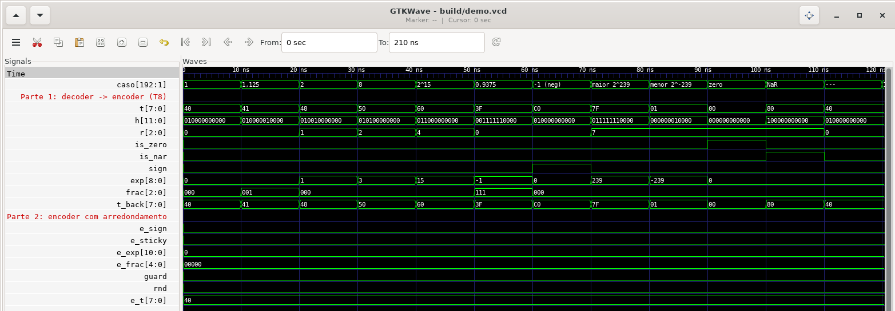
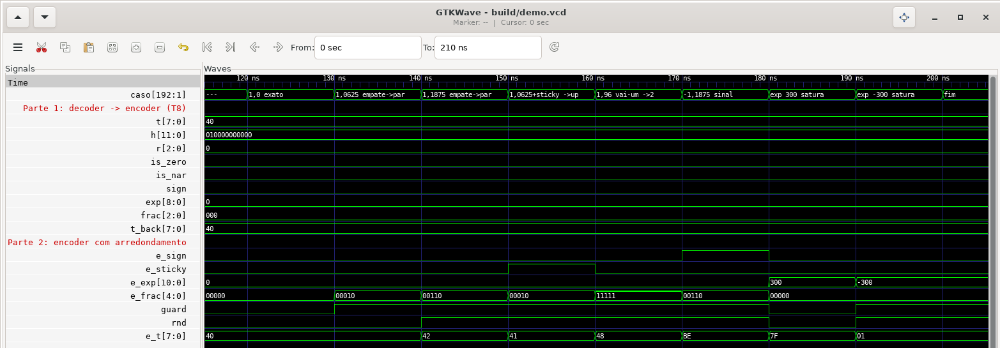
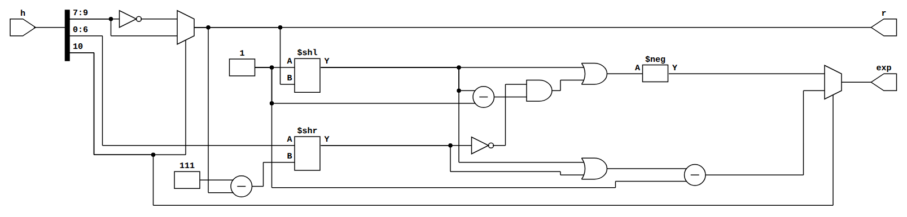
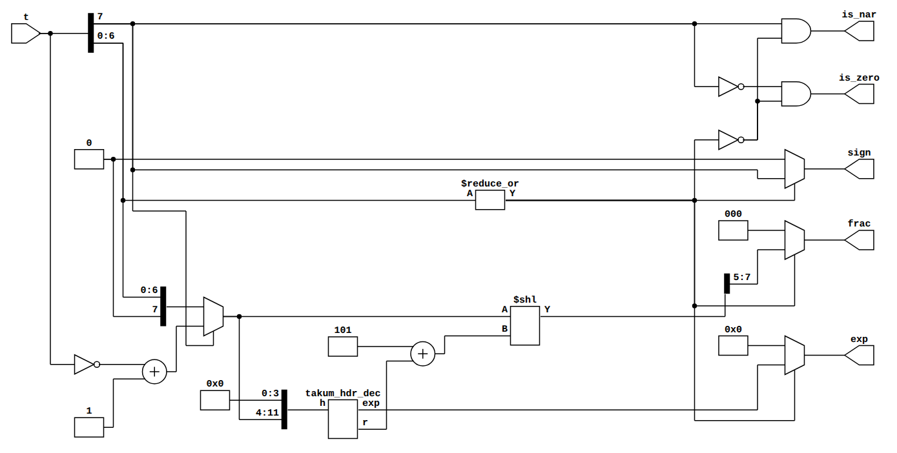
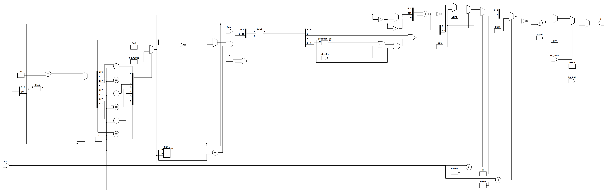

# Fase 1 — Implementação do decodificador e do codificador Takum (Verilog)

**Projeto Integrador AOC 2026/02 — Zvtakum**

Este documento descreve **o que foi implementado**, **como o código funciona** e **como rodar**.
O roteiro com o raciocínio passo a passo está em [`02-fase1-decoder-encoder.md`](02-fase1-decoder-encoder.md).

- Formato: **takum linear** (Hunhold 2024, Definição 8), tamanhos **T8, T16, T32** (o RTL é parametrizado por `N ≥ 8`).
- Linguagem: **Verilog-2005** no RTL, no modelo de referência e nos testbenches do decodificador e do codificador. A ALU (Entrega 1) é verificada também por um oráculo em Python (ver `04-entrega1-alu.md`).
- Situação: **todos os testes passam** para N = 8, 16 e 32; lint do Verilator limpo.

---

## Sumário

1. [Arquivos](#1-arquivos)
2. [Como instalar as ferramentas](#2-como-instalar-as-ferramentas)
3. [Como rodar](#3-como-rodar)
4. [Formato interno (contrato entre os módulos)](#4-formato-interno-contrato-entre-os-módulos)
5. [`takum_hdr_dec` — cabeçalho de 12 bits](#5-takum_hdr_dec--cabeçalho-de-12-bits)
6. [`takum_decoder`](#6-takum_decoder)
7. [`takum_encoder`](#7-takum_encoder)
8. [Verificação](#8-verificação)
9. [Resultados de síntese](#9-resultados-de-síntese)
10. [Limitações e próximos passos](#10-limitações-e-próximos-passos)
11. [Ver as ondas e o circuito](#11-ver-as-ondas-e-o-circuito)

---

## 1. Arquivos

```
rtl/
  takum_hdr_dec.v     cabeçalho de 12 bits: D, R, C -> r e expoente (igual para qualquer N)
  takum_decoder.v     palavra takum de N bits -> formato interno
  takum_encoder.v     formato interno alargado -> palavra takum (arredonda e satura)
tb/
  tb_demo.v           demonstração para ver as ondas (grava build/demo.vcd)
  demo.tcl            script do GTKWave: sinais, grupos e formatos da demonstração
  takum_ref.vh        modelo de referência (funções com real; só testbench)
  tb_ref.v            testa o próprio modelo (valores conhecidos, negação, monotonicidade)
  tb_decoder.v        decoder: exaustivo T8/T16, aleatório T32
  tb_roundtrip.v      encoder(decoder(t)) == t
  tb_encoder.v        encoder por propriedades (saturação, sinal, vizinho mais próximo, empates)
Makefile              test, lint, synth, demo, waves, schematic, clean
docs/img/             capturas das ondas e esquemáticos (SVG e PNG)
```

`build/` (gerado) e `*.vcd` estão no `.gitignore`.

---

## 2. Como instalar as ferramentas

Só o **Icarus Verilog** e o **make** são obrigatórios. Verilator e Yosys são para `make lint` e `make synth`.

| Sistema | Comando |
|---|---|
| Ubuntu / Debian / WSL | `sudo apt install iverilog verilator yosys gtkwave make` |
| macOS (Homebrew) | `brew install icarus-verilog verilator yosys make` (GTKWave: `brew install --cask gtkwave`) |
| Windows | Use o WSL (Ubuntu) com o comando acima, ou o pacote **OSS CAD Suite**, que traz todas as ferramentas |

Versões usadas na validação: Icarus Verilog 12.0, Verilator 5.020, Yosys 0.33.

---

## 3. Como rodar

Na raiz do repositório:

```bash
make test          # compila e roda os 4 testbenches
make lint          # Verilator -Wall para N = 8, 16, 32
make synth         # Yosys: células e LUT6 por módulo e tamanho (salva em build/synth.txt)
make waves         # simula a demonstração e abre as ondas no GTKWave (§11)
make schematic     # desenha o circuito em build/sch/*.svg (§11)
make clean
```

Saída esperada de `make test` (≈ 25 s):

```
PASS tb_ref: 131600 verificações
PASS decoder T8: 256 padrões
PASS decoder T16: 65536 padrões
PASS decoder T32: 200008 padrões
PASS roundtrip T8: 256 padrões
PASS roundtrip T16: 65536 padrões
PASS roundtrip T32: 200000 padrões
PASS encoder T8: 103799 verificações
PASS encoder T16: 110008 verificações
PASS encoder T32: 110009 verificações
==> TODOS OS TESTES PASSARAM
```

Rodar só uma parte: `make ref`, `make decoder`, `make roundtrip`, `make encoder`.

Mais casos aleatórios (para o relatório):

```bash
make test N32=1000000 NENC=500000
```

`N32` = quantidade de padrões aleatórios de T32 no decoder e na ida e volta; `NENC` = entradas aleatórias por tamanho no encoder (os empates usam `NENC/10`).

**Sem `make`** (o que o Makefile faz por baixo):

```bash
mkdir -p build
iverilog -g2005 -Wall -I tb -o build/tb_decoder.vvp tb/tb_decoder.v rtl/*.v
vvp -n build/tb_decoder.vvp +N32=200000
```

### Depurando com formas de onda

Os testbenches não gravam `.vcd` (o exaustivo de T16 geraria arquivos enormes). Para investigar um caso,
crie um testbench pequeno ou acrescente temporariamente, no `initial` do testbench:

```verilog
$dumpfile("build/debug.vcd");
$dumpvars(0, tb_decoder.c16);   // só a instância de 16 bits
```

e abra com `gtkwave build/debug.vcd`. Quando um teste falha, a mensagem `ERRO ...` já mostra a entrada
em hexadecimal, as saídas do RTL e o valor esperado; normalmente isso basta.

---

## 4. Formato interno (contrato entre os módulos)

### Saída do decoder

| Sinal | Largura | Significado |
|---|---|---|
| `is_zero` | 1 | palavra `000…0` |
| `is_nar` | 1 | palavra `100…0` |
| `sign` | 1 | sinal (0 para zero e NaR) |
| `exp` | 9, com sinal | expoente `e`, de −255 a +254 (0 para zero e NaR) |
| `frac` | `N−5` | fração alinhada à esquerda (o MSB vale 1/2); bits que o número não tem são 0 |

**valor = (−1)^sign × (1 + frac / 2^(N−5)) × 2^exp**

### Entrada do encoder

| Sinal | Largura | Significado |
|---|---|---|
| `is_zero`, `is_nar` | 1 | têm prioridade sobre tudo |
| `sign` | 1 | sinal |
| `exp` | 11, com sinal | pode sair de −255…254 (o produto soma expoentes); o encoder satura |
| `frac` | `N−3` | `N−5` bits de fração + **guard** + **round** |
| `sticky` | 1 | OU dos bits já descartados abaixo de `frac` |

**valor = (−1)^sign × (1 + frac / 2^(N−3) [+ algo menor que 2^−(N−3), se sticky]) × 2^exp**

Para ligar o decoder direto no encoder: `exp` com extensão de sinal (`{{2{exp[8]}}, exp}`),
`frac` com dois zeros à direita (`{frac, 2'b00}`), `sticky = 0`. É o que o `tb_roundtrip` faz.

---

## 5. `takum_hdr_dec` — cabeçalho de 12 bits

Arquivo: `rtl/takum_hdr_dec.v`. Recebe os 12 bits de cima de um takum **positivo**:

| Bits | Campo |
|---|---|
| `h[11]` | S (ignorado) |
| `h[10]` | D |
| `h[9:7]` | R |
| `h[6:0]` | janela onde ficam os `r` bits de C |

Como o código calcula cada coisa:

| Linha | O que faz | Por quê |
|---|---|---|
| `r = d ? reg_r : ~reg_r` | `r = D ? R : 7 − R` | em 3 bits, `7 − R` é inverter os bits: não precisa de subtrator |
| `c_bits = h[6:0] >> (3'd7 - r)` | pega os `r` bits de cima da janela | deslocamento de 0 a 7 posições |
| `mask = (1 << r) − 1`, `one = 1 << r` | máscara de `r` bits e o "1 implícito" | |
| `a_pos = one \| c_bits` | `{1, C}` | número de 1 a 255 |
| `a_neg = one \| (~c_bits & mask)` | `{1, ~C}` | |
| `exp = d ? a_pos − 1 : −a_neg` | `c = 2^r − 1 + C` (D=1) e `c = −2^(r+1) + 1 + C` (D=0) | as duas formas são equivalentes às do artigo (verificado no `tb_decoder`) |

O módulo **não tem parâmetro N**: a mesma instância serve T8, T16 e T32. É isso que a §9 mostra em números.

---

## 6. `takum_decoder`

Arquivo: `rtl/takum_decoder.v`. Combinacional, parâmetro `N`.

```
t ──► [zero/NaR] ──────────────────────────────────────► is_zero, is_nar
  ──► sign = t[N-1]
  ──► u = sign ? −t : t   (complemento de 2)
          ├─► h = 12 bits de cima de u (com ghost bits se N < 12) ─► takum_hdr_dec ─► r, exp
          └─► (u << (5 + r)) ─► N−5 bits de cima ─► frac
```

Detalhes da codificação:

1. **Casos especiais.** `rest_zero = ~|t[N-2:0]`. Zero é `~t[N-1] & rest_zero`; NaR é `t[N-1] & rest_zero`.
   Para os dois, as saídas `sign/exp/frac` são forçadas a 0 (assim o núcleo aritmético não recebe lixo).
2. **Negação.** `u = t[N-1] ? (~t + 1) : t`. Pela Proposição 6 de Hunhold, negar a palavra em complemento de 2
   nega o valor. Então o resto do decoder só trata positivos, em que `valor = (1 + f) × 2^c` e `exp = c`.
3. **Cabeçalho.** Um `generate` escolhe: se `N ≥ 12`, `h = u[N-1 -: 12]`; se `N < 12` (T8), `h = {u, zeros}` —
   os bits que faltam são os *ghost bits*, que valem 0 por definição.
4. **Fração.** Ela começa na posição `5 + r` a partir do MSB. `shamt = 5 + r` (4 bits, de 5 a 12) e
   `shifted = u << shamt`; `frac = shifted[N-1 -: N-5]`. Bits que saem pela esquerda somem; os que entram
   pela direita são zeros, exatamente os bits de fração que o número não tem. Em T8 com `r > 3` o
   deslocamento passa de 8 e `frac` vira 0, o que também está certo (não há fração).

Custo: um negador de N bits, um deslocador de 8 posições possíveis e o `takum_hdr_dec`.

---

## 7. `takum_encoder`

Arquivo: `rtl/takum_encoder.v`. Combinacional, parâmetro `N`. Seis etapas:

**1. Faixa do expoente.** `too_big = exp > 254`, `too_small = exp < −255`.

**2. D, r, R, C** (o inverso do `takum_hdr_dec`):

| | D = 1 (`exp ≥ 0`) | D = 0 (`exp < 0`) |
|---|---|---|
| `a` | `exp + 1` | `−exp` |
| `r` | posição do 1 mais significativo de `a` | idem |
| `C` | `a[r-1:0]` | `~a[r-1:0]` |
| `R` | `r` | `~r` |

No código: `d = ~exp[10]`; `a_wide` em 11 bits e `a = a_wide[7:0]` (na faixa válida `a` vai de 1 a 255);
`r` sai de um `casez` (priority encoder 8→3); `c_bits = (d ? a : ~a) & mask`; `reg_r = d ? r : ~r`.

**3. Palavra longa.** `body = {c_bits, frac} << (7 − r)`: `c_bits` tem 7 bits com C alinhado à direita, então
deslocar `7 − r` coloca os `r` bits de C no topo, seguidos da fração, para qualquer `r`.
`full = {1'b0, d, reg_r, body}` tem `N + 9` bits.

**4. Arredondamento (RNE na palavra).**

```verilog
w     = full[N+8:9];            // N bits de cima
guard = full[8];                // primeiro bit descartado
stk   = |full[7:0] | sticky;    // OU do resto
rnd   = guard & (stk | w[0]);   // empate -> par
w_rnd = w + rnd;
```

Somar 1 na palavra funciona mesmo quando o vai-um atravessa a fração e chega em C, R ou D, porque o takum
é **monótono**: o próximo inteiro é sempre o próximo takum (Proposição 4; Algoritmo 1 de Hunhold).

**5. Saturação** (nessa ordem): `too_big` → maior positivo; `too_small` → menor positivo; vai-um chegou ao bit
de sinal (`w_rnd[N-1]`) → maior positivo; `w_rnd == 0` → menor positivo. Takum nunca vira 0 nem NaR por estouro.

**6. Sinal e especiais.** `sign ? (~mag + 1) : mag`; depois `is_nar` → `100…0` e `is_zero` → `000…0`.

> **T8 e o arredondamento na palavra.** Quando os bits descartados incluem bits de **característica**
> (só em T8, para |x| ≥ 2¹⁶ ou |x| < 2⁻¹⁵), arredondar a palavra não é o mesmo que escolher o vizinho
> mais próximo em valor. É o comportamento definido pelo Algoritmo 1 do artigo. O `tb_encoder` só exige
> "vizinho mais próximo" fora dessa região; dentro dela exige que o resultado seja um dos dois vizinhos.

---

## 8. Verificação

Tudo em Verilog, rodando no Icarus.

### 8.1 Modelo de referência (`tb/takum_ref.vh`)

Funções comportamentais (com `real` e `$pow`), escritas **de propósito de outro jeito** que o RTL:

- `ref_value(t, n)` usa a fórmula do artigo **também para negativos** (`e = (−1)^S (c + S)`,
  `valor = ((1 − 3S) + f) · 2^e`), enquanto o RTL nega a palavra e decodifica como positivo.
- calcula `c` com `2^r − 1 + C` e `−2^(r+1) + 1 + C`, enquanto o RTL usa `{1,C} − 1` e `−{1,~C}`.
- `unpacked_value(sign, exp, frac, nf)` converte o formato interno em `real`.

Um `real` é um *double*; todo takum de até 32 bits cabe nele **exatamente**, então os testes comparam com `==`.

### 8.2 O que cada testbench verifica

| Testbench | Verificações | Cobertura |
|---|---|---|
| `tb_ref` | 20 valores conhecidos (revisão, livro, exercícios do guia); `valor(−t) = −valor(t)`; valor cresce com o inteiro com sinal | T8 e T16 completos |
| `tb_decoder` | flags e `unpacked_value(saídas) == ref_value(t)` | T8 e T16 completos; T32: 8 bordas + 200.000 aleatórios |
| `tb_roundtrip` | `encoder(decoder(t)) == t` | T8 e T16 completos; T32: 200.000 aleatórios |
| `tb_encoder` | zero/NaR; 7 casos de faixa de expoente; para entradas aleatórias: nunca 0/NaR, simetria de sinal, saturação, `x` entre os vizinhos, vizinho mais próximo; **empates exatos** vão para o padrão par | ~100.000 por tamanho + ~10.000 empates |

Todos usam **semente fixa** (`$random(seed)`): os resultados são reproduzíveis.

### 8.3 Os testes pegam erros de verdade?

Conferimos introduzindo erros de propósito numa cópia do RTL:

| Erro introduzido | Resultado |
|---|---|
| Encoder arredondando "meio para cima" (`rnd = guard`) em vez de empate para o par | `tb_encoder` falha em T8, T16 e T32 |
| Decoder esquecendo o `− 1` em `c = {1,C} − 1` | `tb_decoder` falha em metade dos padrões |

Repitam esse exercício ao mudar o RTL: um teste que nunca falha não prova nada.

---

## 9. Resultados de síntese

`make synth` (Yosys 0.33, síntese genérica `synth -flatten`; a coluna LUT6 usa `abc -lut 6` como aproximação de FPGA):

| Módulo | Tamanho | Células genéricas | LUT6 |
|---|---|---|---|
| `takum_hdr_dec` | 12 bits (qualquer N) | 135 | 44 |
| `takum_decoder` | T8 | 199 | 47 |
| `takum_decoder` | T16 | 292 | 92 |
| `takum_decoder` | T32 | 453 | 150 |
| `takum_encoder` | T8 | 298 | 74 |
| `takum_encoder` | T16 | 447 | 124 |
| `takum_encoder` | T32 | 751 | 212 |

Como ler para o artigo:

- O **cabeçalho é fixo** (44 LUT6) e é o mesmo para todos os tamanhos. O crescimento do decoder com N vem só
  do **negador** e do **deslocador da fração**, que crescem linearmente com N, mas cujo controle tem sempre
  3 bits (`r`). Num posit, o deslocamento pode ir até quase N e o regime exige um contador de zeros/uns de N bits.
- Os números são de síntese genérica e servem para **comparar tamanhos e alternativas entre si**. Para números
  absolutos de área e atraso, usem o fluxo da FPGA da disciplina (se houver) e citem a ferramenta.
- O codec em VHDL de Hunhold (arXiv:2408.10594) é a referência natural de comparação.

---

## 10. Limitações e próximos passos

- **Combinacional, sem pipeline.** Para frequência alta, registrar entre o cabeçalho e o deslocador.
- **Arredondamento de T8 nas pontas da faixa**: segue a palavra (Algoritmo 1), não o vizinho mais próximo em valor.
  Documentem isso no relatório como decisão de projeto.
- **Síntese genérica**: números relativos, não absolutos.

**Próxima etapa da Fase 1:** núcleo aritmético entre decoder e encoder. **Já implementado**: ver [`04-entrega1-alu.md`](04-entrega1-alu.md). A descrição abaixo é o plano original.

- **Multiplicação:** `sign = sA ^ sB`; `exp = eA + eB` (11 bits); significandos `1.fA × 1.fB` (2·(N−4) bits),
  normalizar se ≥ 2, e entregar ao encoder os `N−3` bits de cima + `sticky` com o OU do resto.
- **Soma/subtração:** subtração = soma com o sinal de B invertido; ordenar por magnitude (comparar as palavras
  como inteiros sem o sinal funciona), alinhar pelo `exp`, somar/subtrair, normalizar (contador de zeros à
  esquerda na subtração) e entregar ao encoder com guard/round/sticky.
- **Testes:** os mesmos padrões deste documento. Para o resultado exato, o modelo de referência pode calcular
  `ref_value(a) * ref_value(b)` e `ref_value(a) + ref_value(b)` em `real`. Isso é exato para T8 e T16; em T32
  o produto (até 56 bits de significando) e algumas somas passam dos 53 bits do `real`, então lá verifiquem
  por propriedades (vizinhança e sinal, como na §8.2) em vez de igualdade.

---

## 11. Ver as ondas e o circuito

### 11.1 Formas de onda

```bash
make waves                                   # simula e abre o GTKWave
# ou, em dois passos:
make demo                                    # grava build/demo.vcd
gtkwave build/demo.vcd -S tb/demo.tcl        # abre com os sinais arrumados
```

O `tb/tb_demo.v` não é um teste de aprovação: ele passa por casos escolhidos, um a cada 10 ns, e o sinal
**`caso`** (formato ASCII) diz o que está na tela. O `tb/demo.tcl` adiciona os sinais em dois grupos e escolhe
o formato de cada um (hexadecimal, binário, decimal com sinal). Para ver outro sinal interno, procure-o na
árvore à esquerda do GTKWave (`tb_demo` → `dec` → `u_hdr` …) e arraste para a lista.

**Parte 1 (0–120 ns): decoder → encoder em T8**



Como ler:

| Caso | `t` | `h` (12 bits) | `r` | `exp` | `frac` | O que observar |
|---|---|---|---|---|---|---|
| 1 | `40` | `0100 0000 0000` | 0 | 0 | `000` | D = 1, R = 000 |
| 1,125 | `41` | | 0 | 0 | `001` | o último bit é fração |
| 2 | `48` | | 1 | 1 | `000` | R = 001: um bit de característica |
| 8 | `50` | | 2 | 3 | `000` | `c = {1,00} − 1 = 3` |
| 2^15 | `60` | | 4 | 15 | `000` | C passa do fim da palavra: ghost bits |
| 0,9375 | `3F` | `0011 1111 0000` | 0 | −1 | `111` | D = 0 (menor que 1) |
| −1 | `C0` | `0100 0000 0000` | 0 | 0 | `000` | `sign = 1`; `h` mostra a palavra **já negada** |
| maior | `7F` | `0111 1111 0000` | 7 | 239 | `000` | os 4 bits de baixo de `h` são ghost bits |
| menor | `01` | | 7 | −239 | `000` | |
| zero, NaR | `00`, `80` | | | 0 | `000` | só as flags `is_zero` / `is_nar` sobem |

Em todos os casos `t_back` (saída do encoder) é igual a `t`: a ida e volta funcionando.

**Parte 2 (120–200 ns): o encoder arredondando**



A entrada `e_frac` tem 5 bits: 3 de fração + **guard** + **round**. `guard` e `rnd` são sinais internos do encoder
(`rnd = 1` quando ele soma 1 na palavra).

| Caso | `e_frac` | `guard` | `rnd` | `e_t` | O que observar |
|---|---|---|---|---|---|
| 1,0 exato | `000_00` | 0 | 0 | `40` | nada a arredondar |
| 1,0625 | `000_10` | 1 | **0** | `40` | empate exato e último bit par: **fica** |
| 1,1875 | `001_10` | 1 | **1** | `42` | empate e último bit ímpar: **sobe** para o par (1,25) |
| 1,0625 + sticky | `000_10` | 1 | 1 | `41` | o sticky diz que passou do meio: sobe |
| 1,96 | `111_11` | 1 | 1 | `48` | o vai-um atravessa a fração e muda o **regime**: vira 2,0 |
| −1,1875 | `001_10` | 1 | 1 | `BE` | mesmo arredondamento, depois complemento de 2 (`−42` = `BE`) |
| exp = 300 | | | | `7F` | satura no maior positivo |
| exp = −300 | | (1) | (1) | `01` | satura no menor positivo; o `rnd` interno não importa porque a saturação de faixa tem prioridade |

### 11.2 O circuito

```bash
make schematic              # build/sch/takum_hdr_dec.svg, takum_decoder.svg, takum_encoder.svg
make schematic SCH_N=16     # o mesmo para T16
```

O Yosys lê o Verilog, faz a elaboração no nível RTL (`prep`) e o **netlistsvg** desenha. Se o netlistsvg não estiver
instalado (`npm install -g netlistsvg`), o alvo usa o Graphviz do próprio Yosys (`show`), com desenho menos limpo.
Abra os SVGs no navegador (dá para dar zoom sem perder qualidade). As versões em `docs/img/` são de T8.

Nesse nível cada bloco é um operador do código: `$shl`/`$shr` são deslocadores, `+`, `−` e `$neg` são
somadores/subtratores, os trapézios são multiplexadores, as barras pretas separam ou juntam fios de um barramento.

**Cabeçalho de 12 bits (`takum_hdr_dec`)** — igual para qualquer N:



Da esquerda para a direita: `h[9:7]` (R) passa pelo inversor e pelo mux que escolhe entre R e ~R com `h[10]` (D) — é o `r`.
`111 − r` controla o `$shr` que tira C da janela `h[6:0]`. O `$shl` faz `1 << r`; o subtrator gera a máscara.
Os dois OUs formam `{1, C}` e `{1, ~C}`; um caminho subtrai 1, o outro passa pelo `$neg`, e o mux final escolhe pelo D.

**Decoder (`takum_decoder`, T8)**:



Embaixo à esquerda, o inversor + somador (`+1`) com o mux é a **negação condicional**. A barra `0:3 / 4:11` junta
os 8 bits com 4 zeros (os **ghost bits**) para formar `h`, que entra no bloco `takum_hdr_dec`. O `r` que sai dele
soma com `101` (5) e controla o `$shl` da fração. À direita, o `$reduce_or` e as portas formam `is_zero`/`is_nar`,
e os três muxes zeram as saídas nos casos especiais.

**Encoder (`takum_encoder`, T8)**: [abrir o SVG](img/takum_encoder.svg) (largo; melhor no navegador).



Da esquerda para a direita: `exp` → `+1` ou `$neg` (o valor `a`); a fileira de comparadores `=` com a constante
grande é o **priority encoder** (o Yosys transformou o `casez` numa tabela); os deslocadores montam a palavra longa;
o `$reduce_or` com `sticky` e as portas formam o arredondamento; o somador `+` aplica o `rnd`; os muxes à direita fazem
a saturação, o complemento de 2 (`+1` depois do inversor) e os casos zero/NaR. Embaixo, os comparadores `<` e `>`
com `0x101` e `0xfe` são os testes `exp < −255` e `exp > 254`.

> Para o artigo, os SVGs do cabeçalho e do decoder podem ir quase direto como figuras. O do encoder fica
> melhor redesenhado como diagrama de blocos (o da §7), citando que foi conferido contra o esquemático.

